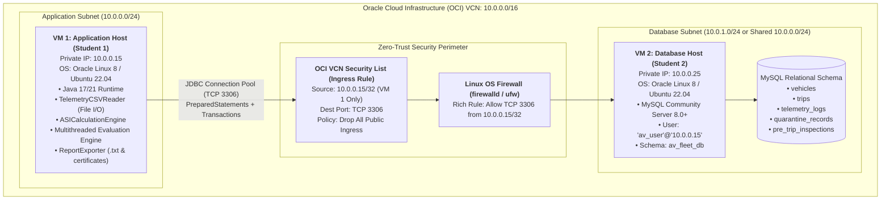
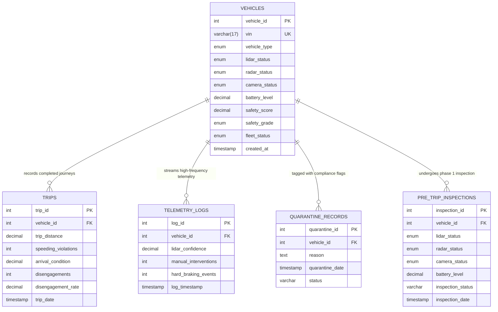

# System Architecture & Network Topology
## Autonomous Vehicle (AV) Fleet Safety & Telemetry Audit Engine

> **Academic Collaboration Project (Set 21)**  
> **Infrastructure Target:** Oracle Cloud Infrastructure (OCI) Enterprise Cloud  
> **Simulation Boundary:** Multi-threaded telemetry and data compliance audit engine simulating real-time AV fleet sensor streams without physical vehicle actuation.

---

## 1. High-Level Distributed Architecture

The system is engineered as a cloud-native, distributed two-tier enterprise architecture separating computational safety auditing from relational data persistence:

---

## 2. Core Architectural Subsystems

### A. Data Ingestion & String Processing Subsystem
- **Source:** [`data/telemetry_logs.csv`](file:///C:/Users/Thina%20rajkumar/.gemini/antigravity/scratch/JAVA%20PROJECT%20AV_FLEET_SAFETY_AUDIT/data/telemetry_logs.csv)
- **Engine:** [`TelemetryCSVReader.java`](file:///C:/Users/Thina%20rajkumar/.gemini/antigravity/scratch/JAVA%20PROJECT%20AV_FLEET_SAFETY_AUDIT/src/TelemetryCSVReader.java)
- **Design Pattern:** Stream Parsing & Robust Validation
- **Operations:**
  - Tokenization using `.split(",")` and sanitization with `.trim()`.
  - Strict boundary enforcement (LiDAR $0\text{--}100$, Interventions $\ge 0$, Hard Brakes $\ge 0$).
  - Malformed records rejected with descriptive logging; valid rows persisted via batch-ready DAO.

### B. Mathematical Safety Engine (Autonomous Safety Index - ASI)
- **Engine:** [`ASIEngine.java`](file:///C:/Users/Thina%20rajkumar/.gemini/antigravity/scratch/JAVA%20PROJECT%20AV_FLEET_SAFETY_AUDIT/src/ASIEngine.java)
- **Formulas Implemented:**
  1. **Disengagement Rate per 100 km:**
     $$\text{Rate} = \left(\frac{\text{Total Manual Interventions}}{\text{Total Trip Distance (km)}}\right) \times 100$$
  2. **Urban Robotaxi:**
     $$\text{ASI} = (\text{Sensor} \times 0.50) + (\text{DisengagementScore} \times 0.30) + (\text{RiderRating} \times 0.20)$$
  3. **Highway Freight Truck:**
     $$\text{ASI} = (\text{Sensor} \times 0.40) + (\text{LaneDiscipline} \times 0.40) + (\text{BrakingResponse} \times 0.20)$$
  4. **Last-Mile Delivery Rover:**
     $$\text{ASI} = (\text{ObstacleDetection} \times 0.60) + (\text{PedestrianAvoidance} \times 0.30) + (\text{SpeedAdherence} \times 0.10)$$
- **Quarantine Override Safeguard:** Irrespective of high sensor scores, any vehicle exceeding its category threshold is immediately forced to `SAFETY_QUARANTINE` and `GROUNDED`.

### C. Concurrency & Multithreading Architecture
- **Engine:** [`MultithreadedFleetAuditEngine.java`](file:///C:/Users/Thina%20rajkumar/.gemini/antigravity/scratch/JAVA%20PROJECT%20AV_FLEET_SAFETY_AUDIT/src/MultithreadedFleetAuditEngine.java) & [`SafetyWorker.java`](file:///C:/Users/Thina%20rajkumar/.gemini/antigravity/scratch/JAVA%20PROJECT%20AV_FLEET_SAFETY_AUDIT/src/SafetyWorker.java)
- **Concurrency Model:** Thread Pool via `ExecutorService` and `Executors.newFixedThreadPool(12)`.
- **Thread Safety:** 
  - Worker threads operate on isolated task models without mutable shared memory.
  - Aggregation uses [`SafetyEvaluationAggregator.java`](file:///C:/Users/Thina%20rajkumar/.gemini/antigravity/scratch/JAVA%20PROJECT%20AV_FLEET_SAFETY_AUDIT/src/SafetyEvaluationAggregator.java) powered by `AtomicInteger` lock-free primitives (`incrementAndGet()`).
  - Database operations use per-thread isolated JDBC `Connection` instances obtained from `DBConnection.getConnection()`.

### D. Compliance & Report Generation Subsystem
- **Engine:** [`ReportExporter.java`](file:///C:/Users/Thina%20rajkumar/.gemini/antigravity/scratch/JAVA%20PROJECT%20AV_FLEET_SAFETY_AUDIT/src/ReportExporter.java)
- **Outputs:**
  - `reports/fleet_safety_report.txt`: Tabular summary of audited vehicles.
  - `reports/quarantine_report.txt`: Registry of grounded vehicles and root-cause violations.
  - `reports/safety_certificate_AV001.txt`: Standardized academic safety certification.

---

## 3. Relational Schema & Entity Relationship Diagram (ERD)

---

## 4. Cloud Network Security Principles

1. **Private Network Routing:** Database communication occurs over private IP address spaces (RFC 1918: `10.0.0.0/16`). No public IPv4 routing is enabled on MySQL port 3306.
2. **Principle of Least Privilege (PoLP):**
   - MySQL user account `'av_user'@'10.0.0.15'` is restricted to `SELECT`, `INSERT`, `UPDATE`, `DELETE` operations strictly on `av_fleet_db`. Administrative grants (`SUPER`, `DROP`, `GRANT OPTION`) are explicitly disallowed.
3. **Defense in Depth (DiD):**
   - Layer 1: OCI Security List packet filtering at the hypervisor boundary.
   - Layer 2: Host OS Linux kernel firewall (`iptables` / `firewalld`).
   - Layer 3: MySQL host/subnet bind verification and credential authentication.
4. **Zero Hardcoded Secrets:** Credentials are read at runtime via environment variables (`DB_HOST`, `DB_PORT`, `DB_NAME`, `DB_USER`, `DB_PASS`).
